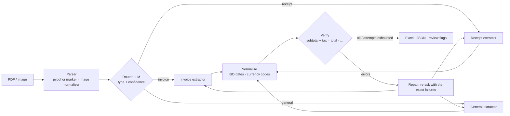

# docidp — document extraction with routing, validation and self-repair

[](https://github.com/asmae2KM/docidp/actions)

Turns invoices, receipts and other documents (PDFs and photos/scans) into **validated structured records** (Excel / JSON).
An LLM router picks the right specialist schema, a deterministic verifier checks the result (totals add up, dates parse,
currencies are real codes), and when a check fails the model is **re-asked with the specific error** instead of silently
returning a wrong number. Anything still doubtful is flagged for human review.

> A synthetic, reproducible benchmark is included (`evaluation/`), with an evaluation harness that reports routing accuracy,
> per-field accuracy, the measured effect of the repair loop, and whether the review flag actually catches errors.

## How it works



The "agentic" part is deliberately small and honest: **extract → verify → repair**, a feedback loop with a deterministic
verifier, bounded by `MAX_REPAIRS`, keeping the best attempt. There are no tools or open-ended planning.
See [docs/ARCHITECTURE.md](docs/ARCHITECTURE.md) for the design decisions and trade-offs.

## Features

- **Schema-enforced output** (Pydantic v2, function-calling). Fields are *nullable*, so a missing value is `null`, not an invented one.
- **Verifier + repair loop** with arithmetic, sign, date and currency checks; best attempt wins, so a repair can never make a result worse.
- **Multi-record documents** (one PDF containing several invoices), European/US number formats, FR/DE/EN labels.
- **Review flags** for validation errors, low routing confidence, or truncated input.
- **Robust parsing**: `pypdf` by default (light), optional `marker` for layout/OCR; scanned PDFs give a clear error; images are EXIF-rotated, flattened onto white (transparent PNGs), downscaled.
- **Security basics**: documents are fenced as untrusted data (prompt-injection trap in the benchmark), upload/page limits, formula-safe Excel cells, no shell interpolation, keys only from the environment.
- **Runs on one free key**: Groq for text *and* vision by default (`TEXT_PROVIDER` / `VISION_PROVIDER` can each be switched to OpenAI). Only the keys you actually use are required.
- **Three interfaces**: CLI, Streamlit UI (results persist across reruns), Python API.

## Quickstart

```bash
pip install -e ".[dev]"            # add ".[marker]" for OCR / layout-aware PDF parsing (installs PyTorch)
cp .env.example .env               # add GROQ_API_KEY (free, no card): covers PDFs and images

docidp extract invoices/ -o report.xlsx --json report.json     # CLI (files or folders)
streamlit run app.py                                           # web UI
```

```python
from docidp import Settings, DocumentPipeline, load_document
from docidp.llm import LangChainBackend

settings = Settings.from_env()
pipeline = DocumentPipeline(LangChainBackend(settings), settings)
result = pipeline.run(load_document(open("invoice.pdf", "rb").read(), "invoice.pdf", settings))
print(result.document_type, result.records, result.needs_review)
```

Docker: `docker build -t docidp . && docker run --rm --env-file .env -p 8501:8501 docidp`

## Evaluation

```bash
make dataset      # regenerate the synthetic benchmark (already committed, deterministic, seed 42)
make eval         # live run: needs a key; rewrites the results block below
                  # free tier? throttle it:  LLM_MAX_RETRIES=8 python -m evaluation.run_eval --delay 20 --update-readme
```

**Dataset** (43 documents, generated by `evaluation/generate_dataset.py`): invoices in four layouts (EN / FR / DE / US-with-only-a-`$`),
single and multi-invoice PDFs, receipts as noisy rotated/blurred JPEG/PNG photos and as PDFs, hard-negative "general" documents
that look invoice-like (purchase order, delivery note, quotation), and two prompt-injection traps.

**Metrics**: routing accuracy · field-level accuracy (type-aware matching: money ±0.01, normalised dates, fuzzy names, list F1) ·
all-fields-correct rate · accuracy **before vs after** the repair loop (same run) · review-flag precision/recall · latency split into parsing vs LLM.

### Results

<!-- RESULTS:START -->
_No live run has been committed yet. Run `make eval` with your API keys and this block is replaced with the measured results
(model names, call counts and failures included)._
<!-- RESULTS:END -->

## Limitations (read before trusting numbers)

- The benchmark is **synthetic**: it tests format/noise robustness, not the long tail of real-world documents. Next step: add SROIE/CORD adapters.
- LLM decoding at `temperature=0` is *mostly* but not perfectly deterministic; expect ±1 document between runs.
- The router's `confidence` is self-reported and poorly calibrated; it is only used as a review trigger.
- Invoices with discounts or shipping lines may fail the `subtotal + tax = total` check; those become review flags, not silent changes.
- Groq's vision models are **previews** that rotate; if `VISION_MODEL` stops working, pick a current one from the Groq docs. Free-plan token caps are per minute, so use `--delay` for benchmark runs.
- If `marker-pdf` is installed, `PDF_PARSER=auto` uses it, and on CPU that takes **minutes per PDF** (first run also downloads models). Set `PDF_PARSER=pypdf` for text PDFs and for benchmark runs.
- Scanned PDFs need the `marker` extra (or upload page images). Documents are sent to third-party LLM APIs: don't use real sensitive data without a data-processing agreement, or point `TEXT_PROVIDER` at a model you host.

## Project layout

```
docidp/               library: config, schemas, prompts, parsers, llm backend, validators, pipeline, export, cli
app.py                Streamlit UI
evaluation/           dataset generator, metrics, runner (+ committed synthetic dataset)
tests/                123 tests, no network: scripted + oracle backends, mocked marker subprocess, Streamlit AppTest
docs/ARCHITECTURE.md  design decisions, threat model
```

`make test` · `make lint` · CI runs both on Python 3.10–3.12.

## License

MIT
